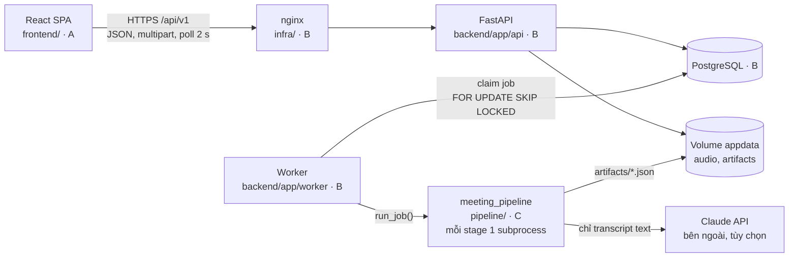

# Kiến trúc hệ thống

> Thiết kế theo kế hoạch 001. Trạng thái ngày 2026-10-19: ✓ đã có trong `main` · ◐ đang ở nhánh cá nhân · ○ chưa có.

## Tổng quan

Modular monolith, chạy trên một máy bằng Docker Compose, GPU là tùy chọn. Không dùng microservices, Redis/Celery hay Kubernetes.



## Thành phần

| Thành phần | Thư mục | Trách nhiệm | Không làm | Owner | Trạng thái |
|---|---|---|---|---|---|
| React SPA | `frontend/` | Upload, recorder có consent, theo dõi xử lý, sửa transcript/speaker/summary/action items, export | Không chạy AI. Không giữ trạng thái xử lý: sau khi refresh, đọc lại từ server. | A | ◐ UI chạy dữ liệu demo, chưa gọi API |
| nginx | `infra/` | Phục vụ file static, reverse proxy `/api`, giới hạn kích thước upload | | B | ○ |
| FastAPI | `backend/app/` | Auth, CRUD meeting, upload, chỉnh sửa có audit, lịch sử, export | Không chạy AI | B | ○ |
| Worker | `backend/app/worker/` | Claim job, lease, heartbeat, retry cấp job, gọi `run_job()`, persist kết quả | Không tự xử lý audio | B | ○ |
| Pipeline | `pipeline/` | 6 stage, runner (subprocess, timeout, checkpoint), CLI | Không biết gì về DB hay HTTP | C | ✓ `preprocess`, `merge` thật; các stage khác mới có bản fake |
| PostgreSQL | | Metadata, jobs, transcript, summary, action items, `ai_outputs`, `edit_events` | | B | ○ |
| Volume `appdata` | | Audio gốc và artifact của từng job | | B (layout), C (artifact) | ○ |
| Claude API | qua `pipeline/meeting_pipeline/llm/` | Tóm tắt và action items | Chỉ nhận transcript text, không nhận audio | C | ○ |

## Ranh giới module

Đây là quy tắc bắt buộc. Muốn vượt ranh giới thì phải đổi contract (xem [contracts.md](contracts.md)), không gọi tắt.

| Module | Được dùng | Không được |
|---|---|---|
| `frontend/` | HTTP `/api/v1` theo `contracts/openapi.json` | Đọc `contracts/pipeline/`, gọi thẳng pipeline hay DB, chứa secret (biến `VITE_*` bị đưa vào bundle) |
| API của `backend/` | DB, storage, các service của backend | Import `meeting_pipeline`, gọi model AI |
| Worker | `meeting_pipeline.runner.run_job`, `meeting_pipeline.runner.overall_progress`, `meeting_pipeline.schemas.JobSpec`, `meeting_pipeline.errors.*`, artifact theo `contracts/pipeline/` | Import các module khác của pipeline (`stages/`, `fake/`…). Muốn fake pipeline thì đặt `PIPELINE_BACKEND=fake`. |
| `pipeline/` | File trong workdir của job, model AI qua adapter | DB, gọi HTTP tới backend, đọc cấu hình của backend |
| Module export (`backend/app/services/export/`) | DTO `MeetingExport` → bytes | Query DB |
| Dịch vụ bên ngoài (Claude API, Hugging Face/pyannote) | Gọi qua một adapter interface, có bản fake cho test | Gọi SDK rải rác trong code |

## Luồng xử lý một cuộc họp

| # | Bước | Owner |
|---|---|---|
| 1 | Người dùng tick consent, chọn file hoặc ghi âm, bấm "Tải lên" | A |
| 2 | `POST /api/v1/meetings` (multipart, header `Idempotency-Key`). API ghi file vào `audio/{meeting_id}/`, tạo meeting và job `queued` trong cùng transaction, trả 201 ngay. | B |
| 3 | Frontend poll `GET /api/v1/jobs/{id}` mỗi 2 s tới khi job kết thúc | A |
| 4 | Worker claim job, ghi `job.json` vào workdir, gọi `run_job()` | B |
| 5 | Runner chạy lần lượt `preprocess → vad → asr → diarize → merge → summarize`. Mỗi stage chạy trong subprocess riêng và ghi `{stage}.json` theo kiểu atomic. | C |
| 6 | `on_stage_done(merge)`: worker persist transcript (đợt 1), người dùng xem và sửa được ngay. `on_stage_done(summarize)`: persist summary và action items (đợt 2). | B |
| 7 | Người dùng sửa: `PATCH` kèm `version`. Backend UPDATE entity và INSERT `edit_events` trong cùng transaction. | A, B |
| 8 | Export: `GET /api/v1/meetings/{id}/export?format=&variant=`. File sinh deterministic từ DB. | A (module export), B (router) |

## Pipeline

| Stage | Input | Output trong workdir | Lỗi chính | Stage thật |
|---|---|---|---|---|
| `preprocess` | File gốc | `audio.wav` (16 kHz mono), `preprocess.json` | `AUDIO_INVALID`, `AUDIO_TOO_SHORT`, `AUDIO_TOO_LONG`: permanent | ✓ AI-05 |
| `vad` | `audio.wav` | `vad.json` | `NO_SPEECH_DETECTED`: permanent | ○ AI-06 |
| `asr` | `audio.wav` | `asr.json` | Timeout, OOM: transient | ○ AI-06 |
| `diarize` | `audio.wav` | `diarization.json`, `diarization.rttm` | Lỗi ở lượt cuối: fallback 1 speaker, job không fail | ○ AI-07 |
| `merge` | `preprocess.json`, `asr.json`, `diarization.json` | `transcript.json` | Lỗi ở đây là bug: permanent | ✓ AI-08 |
| `summarize` | `transcript.json`, hoặc transcript đã sửa qua `transcript_override_path` | `summary.json` | 429/5xx: transient. 400: permanent. Không có key: `status=disabled`. | ○ AI-09 |

`PIPELINE_BACKEND=fake` chạy cả 6 stage bằng dữ liệu mẫu. `FAKE_SCENARIO` chọn kịch bản lỗi (`pipeline/README.md`). Stage chưa có bản thật thì báo `STAGE_NOT_IMPLEMENTED`.

## Lỗi, timeout, retry

| Cấp | Owner | Cơ chế |
|---|---|---|
| Stage | C (runner) | Subprocess trong process group riêng. Timeout = `base + k × duration`, quá hạn thì kill cả group. Stage đã có artifact hợp lệ thì bỏ qua (checkpoint). Exit code 0 = OK, 10 = permanent, 20 = transient; chi tiết lỗi trong `<stage>.error.json`. |
| Job | B (worker) | Lease 60 s, heartbeat 15 s, reaper requeue job hết lease. Tối đa 3 lượt, backoff 30 s → 2' → 8' (± 20 %). Lỗi permanent thì `failed` ngay. |
| Lỗi một phần | B, C | Diarize lỗi: fallback 1 speaker, meeting vẫn `ready`. Summarize lỗi: meeting `partial`, transcript vẫn dùng được, có nút tạo lại tóm tắt (`from_stage=summarize`). |
| HTTP | B | Error envelope `{"error": {"code", "message", "details", "request_id"}}`. Mã lỗi ổn định, liệt kê trong `contracts/error_codes.md`. |

## Lưu trữ

```text
appdata/
├── audio/{meeting_id}/original.<ext>
└── artifacts/{meeting_id}/{job_id}/        # workdir của job
    ├── job.json                            # worker ghi trước khi gọi run_job()
    ├── audio.wav, playback.m4a             # playback.m4a chỉ có khi trình duyệt không phát được file gốc
    ├── preprocess.json, vad.json, asr.json, diarization.json, diarization.rttm
    ├── transcript.json, summary.json
    └── <stage>.error.json                  # khi stage lỗi
```

Bảng chính trong PostgreSQL (B chốt ở BE-03): `users`, `meetings`, `jobs`, `ai_outputs`, `speakers`, `segments`, `summaries`, `action_items`, `edit_events`, `idempotency_keys`.

Nguyên tắc dữ liệu:

- **Bản AI gốc là bất biến:** bảng `ai_outputs` và các cột `ai_*` không bao giờ bị UPDATE. Người dùng chỉ sửa bản hiện tại.
- **Mỗi lần sửa ghi đúng 1 dòng `edit_events`** trong cùng transaction. Bảng này append-only, có trigger chặn UPDATE.
- **Chạy lại ASR/diarize khi đã có chỉnh sửa** trả 409 `HAS_USER_EDITS`. MVP không merge các phiên bản.
- **Xóa meeting** là xóa ngay audio, artifact và các row liên quan.

## Công nghệ

| Phần | Lựa chọn | Trạng thái |
|---|---|---|
| Frontend | React 19, TypeScript strict, Vite, React Router, TanStack Query, Vitest + React Testing Library, Node.js 24 | ◐ |
| Backend | Python 3.12, FastAPI, Pydantic v2, SQLAlchemy 2 + Alembic, PostgreSQL 16, PyJWT, argon2 | ○ B chốt ở BE-01 |
| Pipeline | Python 3.12, Pydantic v2, FFmpeg/ffprobe | ✓ |
| Model AI | faster-whisper + Silero VAD (ASR), pyannote.audio (diarization), Claude API `claude-opus-5-5` (tóm tắt) | ○ chốt ở Gate G1 sau spike AI-01, AI-02 |
| Evaluation | jiwer (WER/CER), pyannote.metrics (DER) | ✓ jiwer · ○ pyannote.metrics |
| Triển khai | Docker Compose, file override cho GPU | ○ |
| CI | GitHub Actions, mỗi module một workflow | ✓ |

Worker và pipeline chạy chung một môi trường Python: runner gọi `sys.executable -m meeting_pipeline run-stage …`. Vì vậy backend dùng Python 3.12, giống `pipeline/.python-version`.
